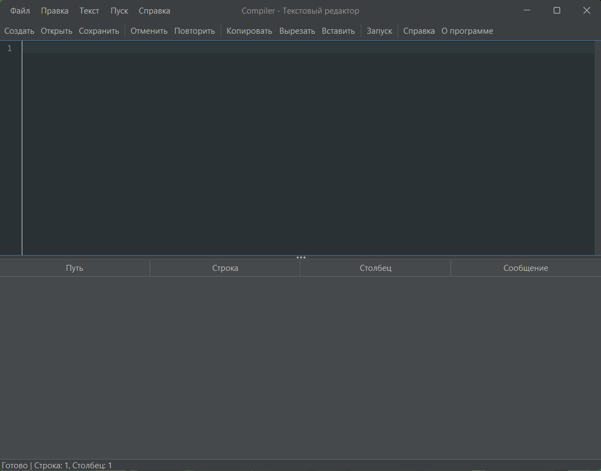
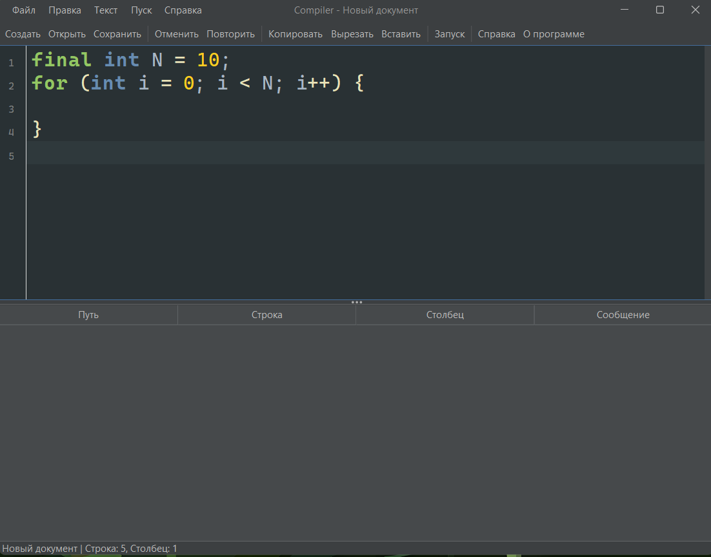
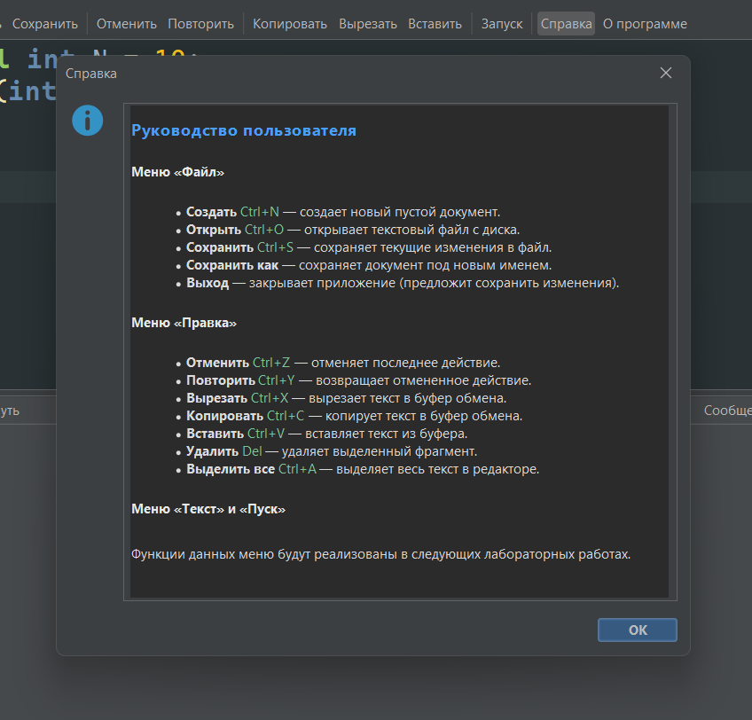

# Parser

## Возможности

- Редактирование текста с подсветкой синтаксиса Java, нумерацией строк и сворачиванием кода
- Создание, открытие, сохранение файлов (любой текстовый формат)
- Открытие файла перетаскиванием (Drag-and-Drop) в окно редактора
- Область вывода результатов в виде таблицы (Путь / Строка / Столбец / Сообщение) - задел под анализатор
- Клик по строке таблицы перемещает курсор в редакторе на указанную строку
- Изменение размера шрифта: `Ctrl` + колесо мыши
- Контроль несохранённых изменений при закрытии, создании и открытии файла
- Встроенная справка и окно «О программе»

---

## Системные требования

- ОС: Windows / Linux / macOS
- Java: JRE 21 или выше
- IDE не требуется - все зависимости упакованы в JAR

---

## Запуск

**Двойной клик** по `Parser-1.0-SNAPSHOT.jar` (если `.jar` ассоциирован с `javaw.exe`).

**Или из командной строки:**

    java -jar Parser-1.0-SNAPSHOT.jar

---

## Интерфейс

Окно разделено на области:

- **Главное меню** - Файл, Правка, Текст, Пуск, Справка
- **Панель инструментов** - кнопки основных команд
- **Область редактирования** - верхняя часть с подсветкой и номерами строк
- **Область вывода результатов** - нижняя часть, таблица ошибок
- **Строка состояния** - внизу окна

Размер областей редактирования и вывода меняется перетаскиванием разделителя.

---

## Руководство пользователя

### Файлы

- **Создать** (`Ctrl+N`) - новый документ. Если есть несохранённые изменения, программа предложит сохранить.
- **Открыть** (`Ctrl+O`) - выбор файла через диалог. Также можно перетащить файл из проводника прямо в редактор.
- **Сохранить** (`Ctrl+S`) - сохранение текущего файла.
- **Сохранить как** - сохранение под новым именем.
- **Выход** - при наличии несохранённых изменений появляется диалог: Сохранить / Не сохранять / Отмена.

### Редактирование

Стандартные операции доступны из меню **Правка** и через горячие клавиши (см. таблицу ниже).

Изменение размера шрифта: зажать `Ctrl` и крутить колесо мыши над редактором (диапазон 8–72 pt). Размер применяется и к таблице.

### Область вывода результатов

Таблица с колонками **Путь**, **Строка**, **Столбец**, **Сообщение**. Сейчас пуста - заполняется будущим анализатором. Клик по строке перемещает курсор в редакторе на указанную строку.

### Строка состояния

Показывает текущее действие («Готово», «Открыт: file.cpp», «Сохранено: file.cpp») и позицию курсора («Строка: N, Столбец: M»), обновляется в реальном времени.

### Справка

- **Вызов справки** - окно с описанием всех функций меню (содержимое в `help.html`).
- **О программе** - версия и краткое описание.

---

## Горячие клавиши

| Клавиши | Действие |
|---|---|
| `Ctrl+N` | Создать |
| `Ctrl+O` | Открыть |
| `Ctrl+S` | Сохранить |
| `Ctrl+Z` | Отменить |
| `Ctrl+Y` | Повторить |
| `Ctrl+X` | Вырезать |
| `Ctrl+C` | Копировать |
| `Ctrl+V` | Вставить |
| `Ctrl+A` | Выделить всё |
| `Delete` | Удалить выделенное |
| `Ctrl` + колесо | Размер шрифта |

---

## Сборка

Требуется JDK 21 и Maven 3.6+. В корне проекта:

    mvn clean package

Готовый JAR: `target/Parser-1.0-SNAPSHOT.jar`.

Зависимости (скачиваются Maven, упаковываются в JAR):

- **RSyntaxTextArea 3.5.0** - подсветка синтаксиса, нумерация строк
- **FlatLaf 3.5.1** - тёмная тема Swing